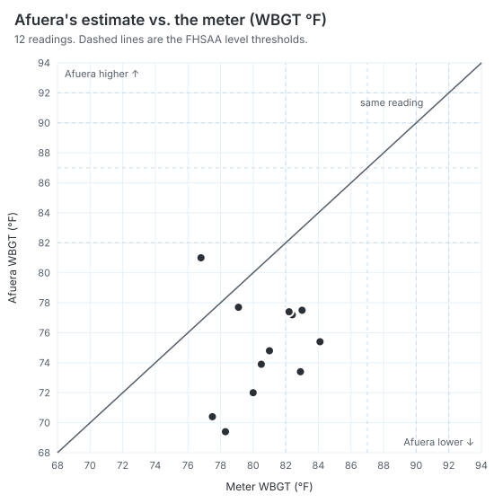

# Afuera vs. a WBGT meter

Readings: `data/meter/sample-readings.csv` · Generated 2026-10-19 · Weather: Open-Meteo Historical Forecast API (CC BY 4.0)

> **Sample input.** This report was made from made-up test data to check the tool works. It is not evidence. Run the tool again on the real data.

**Sample size: 12 readings.** That's a small sample: treat these numbers as a first look, not a measured accuracy.

## Summary

| | |
|---|---|
| Average gap | 6.3 °F |
| Largest gap | −9.5 °F (Sun, Oct 18, 12:30 PM, turf field, full sun) |
| Bias (Afuera − meter) | −5.6 °F. Afuera runs low (less cautious than the meter) on average. |
| Root-mean-square gap | 6.7 °F |
| Same heat level as the meter | 7 of 12 (58%) |
| Afuera one or more levels higher | 0 of 12 |
| Afuera one or more levels lower | 5 of 12 |

## Every reading

| Time | Notes | Meter (°F) | Level | Afuera (°F) | Level | Gap |
|---|---|---|---|---|---|---|
| Sat, Oct 17, 10:00 AM | practice field, full sun | 76.8 | Lower | 81.0 | Lower | +4.2 °F |
| Sat, Oct 17, 11:00 AM | practice field, full sun | 79.1 | Lower | 77.7 | Lower | −1.4 °F |
| Sat, Oct 17, 12:00 PM | practice field, full sun | 81.0 | Lower | 74.8 | Lower | −6.2 °F |
| Sat, Oct 17, 1:00 PM | practice field, full sun | 82.4 | Elevated | 77.2 | Lower | −5.2 °F |
| Sat, Oct 17, 2:00 PM | practice field, full sun | 83.0 | Elevated | 77.5 | Lower | −5.5 °F |
| Sat, Oct 17, 3:00 PM | practice field, full sun | 82.2 | Elevated | 77.4 | Lower | −4.8 °F |
| Sat, Oct 17, 4:00 PM | practice field, light wind | 80.5 | Lower | 73.9 | Lower | −6.6 °F |
| Sat, Oct 17, 5:00 PM | practice field, sun low | 78.3 | Lower | 69.4 | Lower | −8.9 °F |
| Sun, Oct 18, 10:30 AM | turf field, full sun | 77.5 | Lower | 70.4 | Lower | −7.1 °F |
| Sun, Oct 18, 12:30 PM | turf field, full sun | 82.9 | Elevated | 73.4 | Lower | −9.5 °F |
| Sun, Oct 18, 2:30 PM | turf field, still air | 84.1 | Elevated | 75.4 | Lower | −8.7 °F |
| Sun, Oct 18, 4:30 PM | turf field, clouds | 80.0 | Lower | 72.0 | Lower | −8.0 °F |

The same table is in `meter-sample-readings.csv`.

## How this was worked out

- Afuera's number for each reading is what the app would have shown at that time: the WBGT of the forecast hour covering it, from the same engine (Liljegren model), rounded up to 0.1 °F like the app.
- Levels for both use the FHSAA table (Policy 41.8.3), so a meter reading of 87.0 °F is Elevated and 87.1 °F is High.
- Weather is from Open-Meteo for the meter's location (forecast data for a grid square about 1–10 km wide), not measured on the field.

## Limits

- A forecast can't see the exact spot: turf, asphalt, shade, a building blocking the wind. The meter does.
- Meters differ too. Note the meter model, and whether it was in the sun at chest height, in the notes column.
- Calm wind is the known weak spot: the model can read high when forecast wind is near zero.
