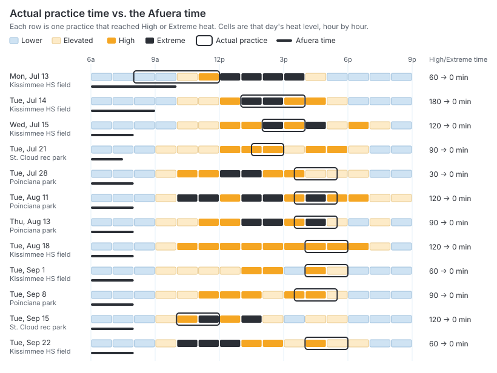

# What if they had used Afuera?

Schedule: `data/what-if/sample-schedule.csv` · Generated 2026-10-19 · Weather: Open-Meteo Historical Forecast API (CC BY 4.0)

> **Sample input.** This report was made from made-up test data to check the tool works. It is not evidence. Run the tool again on the real data.

## Summary

| | |
|---|---|
| Practices checked | 18 |
| Practices that reached High or Extreme heat | 12 of 18 (67%) |
| Time spent in High/Extreme heat | 19 h 0 min of practice time |
| …of that, at 92.1 °F WBGT or above (FHSAA: no outdoor activity) | 2 h 0 min |
| Practices that could have moved to a lower-risk time the same day | 12 of 12 |
| Time in High/Extreme heat that moving would have avoided | 19 h 0 min (100% of it) |

Minutes are practice minutes (clock time), not multiplied by the number of kids.

## Actual time vs. the Afuera time

## Practices that reached High or Extreme

| Date | Actual time | Peak level (WBGT °F) | High/Extreme time | Afuera time | Level there | High/Extreme time there |
|---|---|---|---|---|---|---|
| Mon, Jul 13 | 8:00 AM–12:00 PM | High (87.6) | 1 h 0 min | 6:00 AM–10:00 AM | Lower | 0 min |
| Tue, Jul 14 | 1:00 PM–4:00 PM | Extreme (95.3) | 3 h 0 min | 6:00 AM–9:00 AM | Lower | 0 min |
| Wed, Jul 15 | 2:00 PM–4:00 PM | Extreme (90.1) | 2 h 0 min | 6:00 AM–8:00 AM | Lower | 0 min |
| Tue, Jul 21 | 1:30 PM–3:00 PM | High (88.9) | 1 h 30 min | 6:00 AM–7:30 AM | Lower | 0 min |
| Tue, Jul 28 | 3:30 PM–5:30 PM | High (88.5) | 30 min | 6:00 AM–8:00 AM | Lower | 0 min |
| Tue, Aug 11 | 3:30 PM–5:30 PM | Extreme (97.3) | 2 h 0 min | 6:00 AM–8:00 AM | Lower | 0 min |
| Thu, Aug 13 | 3:30 PM–5:30 PM | Extreme (91.2) | 1 h 30 min | 6:00 AM–8:00 AM | Lower | 0 min |
| Tue, Aug 18 | 4:00 PM–6:00 PM | High (89.9) | 2 h 0 min | 6:00 AM–8:00 AM | Lower | 0 min |
| Tue, Sep 1 | 4:00 PM–6:00 PM | High (87.2) | 1 h 0 min | 6:00 AM–8:00 AM | Lower | 0 min |
| Tue, Sep 8 | 3:30 PM–5:30 PM | High (89) | 1 h 30 min | 6:00 AM–8:00 AM | Lower | 0 min |
| Tue, Sep 15 | 10:00 AM–12:00 PM | Extreme (90.5) | 2 h 0 min | 6:00 AM–8:00 AM | Lower | 0 min |
| Tue, Sep 22 | 4:00 PM–6:00 PM | High (88) | 1 h 0 min | 6:00 AM–8:00 AM | Lower | 0 min |

Every practice, minute by minute, is in `what-if-sample-schedule.csv`.

## How this was worked out

- For each practice, the tool downloads that day's hourly weather for the practice location from Open-Meteo's archive of past forecasts: the same kind of data the app uses.
- Afuera's engine turns each hour into WBGT (Liljegren model) and a heat level (FHSAA Policy 41.8.3), exactly as in the app. Each minute of the practice gets the level of the forecast hour it falls in.
- The "Afuera time" is what the Better time screen would have picked for that day: the lowest-risk window of the same length between 6 AM and 9 PM, skipping thunderstorms and hours with more than 40% rain chance. A move only counts if that window is at a lower level than the practice's worst hour.

## Limits

- These are estimates from forecast data, not readings taken on the field. Shade, turf, asphalt and uniforms change the real heat stress.
- It assumes the program could have moved to any time that day. School hours, field bookings and buses may rule some times out.
- It counts time spent in High/Extreme heat. It does not, and can't, say how many kids would or wouldn't have gotten sick.
